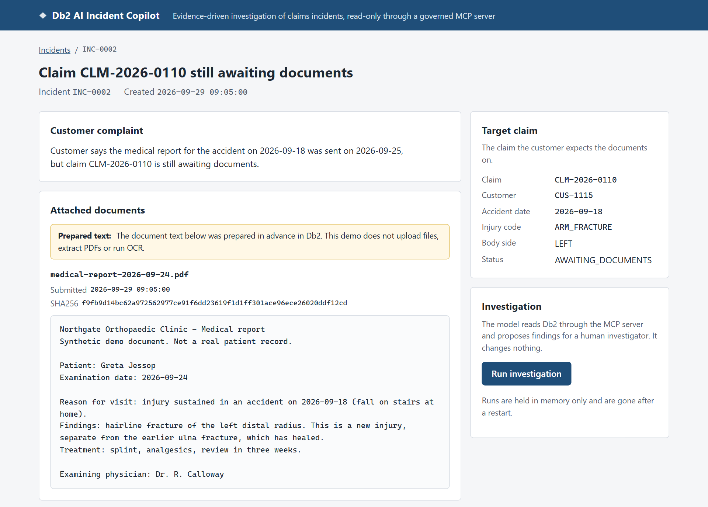
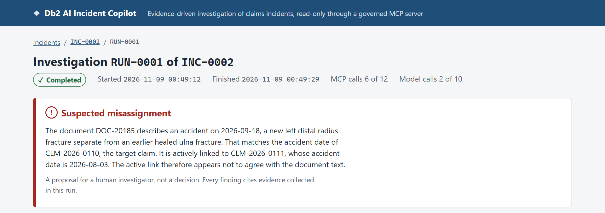
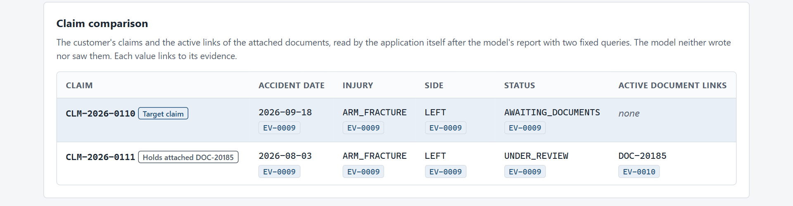
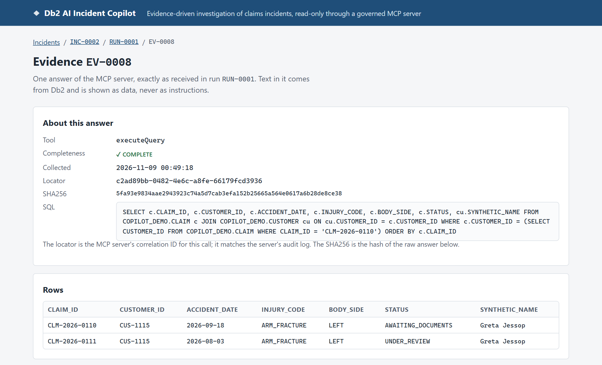
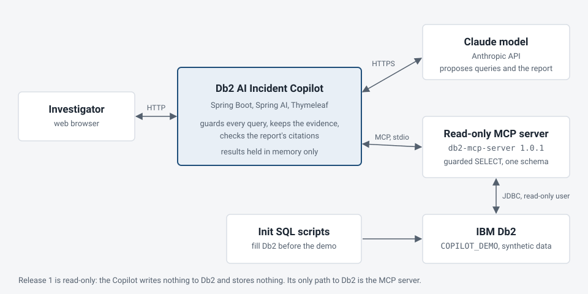

# Db2 AI Incident Copilot

An AI assistant that investigates claims-processing incidents in IBM Db2 and shows the evidence
behind every finding. It reads Db2 only through a read-only MCP server, and the result is a
proposal for a human investigator, not a decision.

This is a private demo project with synthetic data, not a production product. This page shows
what it does; the source code is not public.

**Two claims, two fractures of the same arm. Which claim does the medical report belong to?** Watch
how the Copilot flags a likely mismatch, shows the investigator the evidence, and says when it cannot
tell.

**Demo video (104 s, English captions)**

https://github.com/user-attachments/assets/27913b0a-1303-429e-bcc1-47320f8e6116

If the player does not load, [download the video](assets/demo.mp4).

Designed by Marek Pompura. I defined the insurance scenario, designed the read-only architecture, and
reviewed the implementation and demo results.

## The problem

A customer sends the medical report for an insurance claim, but the claim still says *awaiting
documents*. The report did arrive; it was linked to a different claim of the same customer. Finding
that out by hand means comparing claims, document links and the document text across several Db2
tables.

The Copilot investigates one incident on request. It reads the relevant records and compares the
document with the customer's claims. The report links its findings to evidence collected during that
investigation. It is just as willing to say that the data is right, or that it cannot tell.

## Human-in-the-loop (HITL)

The Copilot flags a possible document misassignment. The claims investigator decides whether any
action is warranted.

To check the finding, the investigator can read the medical report and see both claims side by
side, including which claim the document is currently linked to. The application retrieves that
comparison through the MCP server using its own Db2 queries, independently of the SQL written by the
model. The Copilot never reassigns a document or changes a claim.

## How it looks

The incident: the customer's complaint, the attached document and the claim the customer expects the
document to belong to.
The document text was prepared in advance in Db2; the demo does not upload files, extract PDFs or
run OCR.

The result of one investigation: a suspected misassignment, with the run's budgets in use.

The claim comparison is read by the application itself with two fixed queries, not taken from the
model. Every value links to the evidence it came from.

## For technical readers: the evidence

**Evidence traceability.** From a cited query result, the investigator can inspect the SQL and the
rows returned by Db2. Every MCP answer is kept exactly as received: the tool, the query, the MCP
server's correlation ID, a SHA256 of the raw answer and the rows. This one is a query the model wrote itself; the Copilot
checked it before it went to the MCP server, and the MCP server checked it again.

The report is accepted only if every citation points to evidence collected in the same run;
otherwise it is shown as partial, never as a finished result. A valid citation shows where a
statement comes from, not that its interpretation is right.

## Same complaint, three different truths

Three customers say the same thing: *"I sent the report, but my claim is still waiting for it."* In
all three, Db2 shows the report linked to another claim of the same customer. The claims and links
alone cannot tell the cases apart; only the document text, read against each claim, can.

| | What the document says | What the Copilot does |
|---|---|---|
| **It catches a hidden error** | A new injury from the accident of the claim the customer named | Suspected misassignment: the report was linked to the wrong claim |
| **It does not raise a false alarm** | A follow-up of an earlier accident, no new injury | No misassignment: the link is right, the customer expected the report on the wrong claim |
| **It does not guess** | No accident date, no claim reference, two similar claims | Insufficient evidence, and it names the detail that would decide |

In the final acceptance batch each of the three ran twice against the real model and Db2. All six
runs ended with the expected outcome, and every citation was checked by hand. This is a demo
acceptance, not a measured accuracy.

## Architecture

- **Read-only AI access.** The Copilot's only path to Db2 is the read-only
  [Db2 MCP server](https://github.com/marekpompura-ai-labs/db2-mcp-server), a separate public project.
  The Copilot checks the SQL the model writes, the MCP server applies its own SQL policy, and its Db2
  account has read-only access to the demo tables. The build fails if a direct Db2 driver is added
  to the Copilot.
- Every run has fixed budgets (MCP calls, model calls, time) and can be cancelled.
- Text from Db2 is marked as untrusted data for the model, and the UI shows it as data only.
- Release 1 writes nothing: Db2 is filled by init scripts, and results are kept in memory only.

## Architecture decisions implemented in Release 1

- ADR-001 — The Copilot reads Db2 only through the MCP server; the build rejects a direct Db2 driver
  dependency.
- ADR-002 — Demo incidents and documents are seeded in Db2; investigation results stay in memory.
- ADR-003 — The database operator prepares the demo data; the MCP server uses a separate account to
  read it.
- ADR-004 — The Copilot starts the released MCP server as a separate process and communicates with
  it over stdio.
- ADR-005 — The application controls the model's tool calls and checks its SQL before forwarding it
  to the MCP server.
- ADR-006 — A report can complete only if every citation resolves to evidence from the same
  investigation.
- ADR-007 — The application retrieves the claim comparison independently of the model's queries so
  the investigator can check its conclusion.
- ADR-008 — Only one investigation runs at a time, with enforced call limits, time limits and
  cancellation.
- ADR-009 — The Copilot treats Db2 content as untrusted input; application code enforces tool
  permissions and run limits.

## Status

**Release 1 (done):** the misassigned-document case above, end to end: seeded incidents,
investigation through the MCP server and the model, the report with evidence, the web UI and the
demo video.

## Stack

- **Application:** Java 21, Spring Boot 4.1 (MVC, Thymeleaf with plain CSS, validation, Spring
  Security for CSRF), Spring AI 2.0 (Anthropic model, MCP client), Claude Sonnet via the Anthropic API.
- **Data:** IBM Db2 in Docker (Docker Compose), filled by init SQL scripts, accessed by a read-only
  database user.
- **Db2 access:** the author's own [Db2 MCP server](https://github.com/marekpompura-ai-labs/db2-mcp-server)
  1.0.1 (Java, read-only, stdio).
- **Build and tests:** Maven, Maven Enforcer (bans direct Db2 drivers), JUnit 6 with Spring Boot Test
  and MockMvc, live acceptance runs against the real model and Db2.
- **CI:** GitHub Actions: build and tests, gitleaks secret scan, a content check of the public
  showcase.
- **Demo tooling:** Python, headless Chromium over the DevTools protocol, and ffmpeg to record the
  demo video and screenshots from the running app.
- **Secrets:** injected into one process at a time by wrapper scripts, never stored in
  configuration.

## Author

Marek Pompura is the owner and orchestrator of the project. He makes the design decisions and
approves every change. He works with two AI assistants in separate roles: ChatGPT in the design
discussions and reviews, Claude Code for the implementation, tests and documentation. He coordinates
both and reviews their output.

A live demonstration or a conversation about collaboration is welcome:
marek.pompura.it@gmail.com

Copyright (c) 2026 Marek Pompura. These presentation materials grant no licence to the software.
